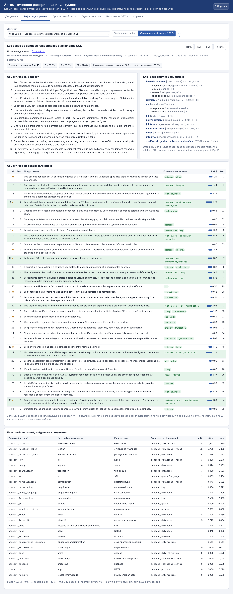

# ЕЯзИИС

Лабораторные работы по дисциплине «Естественно-языковой интерфейс интеллектуальных систем» (БГУИР).
Каждая работа — отдельное веб-приложение на **FastAPI + PostgreSQL**, зависимости ставятся через **[uv](https://docs.astral.sh/uv/)**.


| № | Тема | Что внутри | Порт |
|---|---|---|---|
| [ЛР 1](lab1/) | Информационно-поисковая система и оценка качества поиска | векторная модель TF-IDF, лемматизация pymorphy3, классификация документов по темам, загрузка страниц из интернета, P/R/F1/AP | 8000 |
| [ЛР 2](lab2/) | Автоматическое распознавание языка текста | английский и французский; методы частотных слов, коротких слов и нейросетевой (MLP); 30 тестовых PDF | 8002 |
| [ЛР 3](lab3/) | Автоматическое реферирование документов | французский и итальянский; sentence extraction и семантический метод OSTIS по базе знаний в SCs; P/R/F1, ROUGE | 8003 |

Задания ко всем работам (в том числе 4–9) лежат в [`tasks/`](tasks/).

<p align="center">
  
</p>

## Что нужно установить

1. **uv** — менеджер пакетов и окружений. Python отдельно ставить не нужно: uv сам скачает подходящую версию.

   ```powershell
   # Windows (PowerShell)
   powershell -ExecutionPolicy ByPass -c "irm https://astral.sh/uv/install.ps1 | iex"
   ```
   ```bash
   # Linux / macOS
   curl -LsSf https://astral.sh/uv/install.sh | sh
   ```

2. **PostgreSQL** 14+ (проверено на 16). Один раз от имени суперпользователя создайте пользователя `ips` и базы `lab1`, `lab2`, `lab3`:

   ```bash
   psql -U postgres -f setup_db.sql
   ```
   На Windows, если `psql` нет в PATH: `"C:\Program Files\PostgreSQL\16\bin\psql.exe" -U postgres -f setup_db.sql`.

   Таблицы каждое приложение создаёт само при первом запуске.

## Быстрый старт

```bash
git clone <адрес репозитория>
cd eyzis-labs/lab3          # или lab1 / lab2
uv sync                     # создаёт .venv и ставит зависимости строго по uv.lock
uv run uvicorn app:app --port 8003
```

Откройте http://127.0.0.1:8003. Команды запуска и порядок работы для каждой лабы — в её README.

Подключение к базе по умолчанию: `localhost:5432`, пользователь `ips` / пароль `ips`, база `labN`.
Всё это переопределяется переменными окружения `PGHOST`, `PGPORT`, `PGDATABASE`, `PGUSER`, `PGPASSWORD`.

## Структура репозитория

```
eyzis-labs/
├── setup_db.sql        пользователь ips и базы lab1, lab2, lab3
├── tasks/              задания к лабораторным работам (PDF)
├── lab1/               ИПС: код, docs/ (отчёт, схемы, скриншоты)
├── lab2/               распознавание языка: код, corpus/, tools/, results/, docs/
└── lab3/               реферирование: код, kb/ (база знаний SCs), corpus/, tools/, results/, docs/
```

В каждой лабе:
- `pyproject.toml` + `uv.lock` — зависимости;
- `docs/` — отчёт `.docx` и схемы;
- `data/` — рабочие файлы приложения (загруженные документы, обученные модели). Они создаются автоматически и в git не попадают.

## Полезно знать

- **OneDrive.** Если проект лежит в папке OneDrive, uv не может делать жёсткие ссылки из кэша (`os error 396`). Поэтому во всех `pyproject.toml` указано `link-mode = "copy"`.
- **Вспомогательные скрипты.** Бенчмарки, графики, скриншоты и сборка отчётов лежат в `tools/` и требуют группу зависимостей `dev`. `uv sync` ставит её по умолчанию; без неё — `uv sync --no-dev`.
- **Порты.** Порты разные, поэтому все три приложения можно запустить одновременно.
