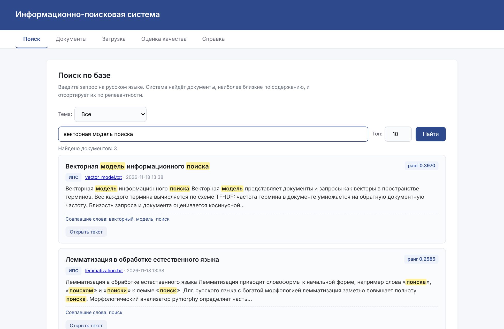
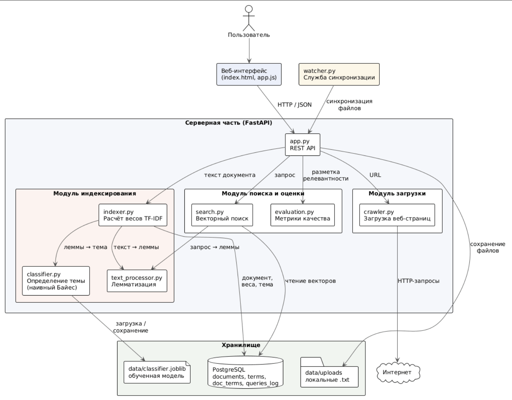
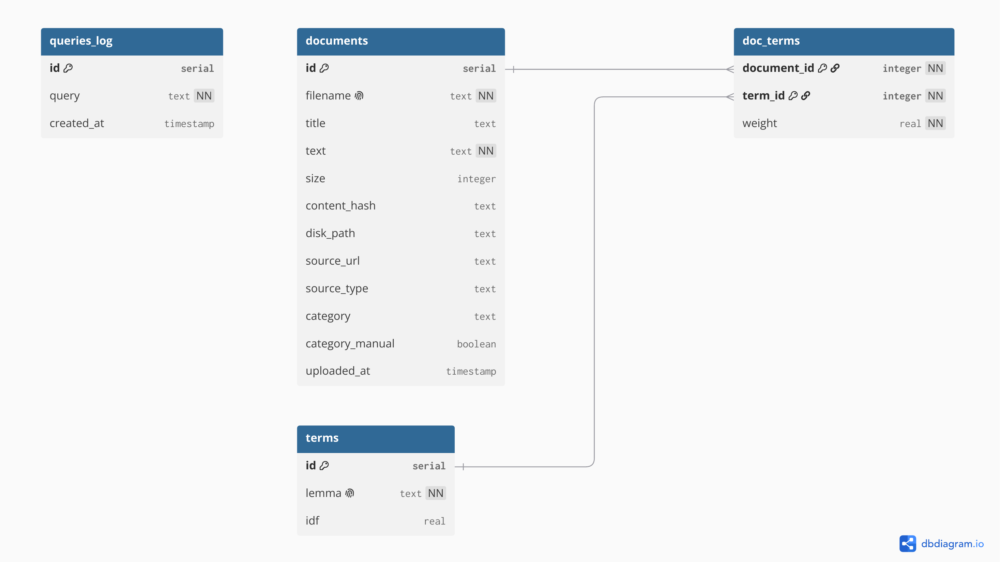

# ЛР 1. Информационно-поисковая система

Вариант 16: векторная модель поиска, русский язык, документы из сети Интернет.

Система загружает документы: веб-страницы по ссылке или локальные `.txt`. Документы лемматизируются (pymorphy3) и индексируются с весами TF-IDF. Поиск ранжирует документы по косинусной мере. Каждому документу автоматически присваивается тема (наивный байесовский классификатор). Качество поиска оценивается метриками Precision, Recall, F1 и AP.



## Запуск

```bash
psql -U postgres -f setup_db.sql     # однократно: пользователь ips и база lab1
uv sync
uv run uvicorn app:app --port 8000
```

Откройте http://127.0.0.1:8000:
1. На вкладке «Загрузка» вставьте ссылки на страницы или перетащите `.txt`-файлы.
2. На вкладке «Поиск» введите запрос на русском языке.
3. На вкладке «Оценка качества» отметьте релевантные документы и получите P / R / F1 / AP.

### Синхронизация папки (необязательно)

Служба `watcher.py` следит за папкой `data/uploads/`: новые и изменённые файлы сами отправляются на сервер, удалённые — удаляются из индекса. Запускается во втором терминале, пока работает сервер:

```bash
uv run python watcher.py
```

### Тест производительности

Скрипт загружает 27 статей Википедии и замеряет время скачивания, индексации и поиска. Нужен запущенный сервер и доступ в интернет:

```bash
uv run python tools/benchmark.py
```

## Как это работает

| Этап | Модуль | Что делает |
|---|---|---|
| Загрузка | `crawler.py` | скачивает страницу (requests + newspaper3k / BeautifulSoup) и извлекает основной текст |
| Предобработка | `text_processor.py` | токенизация, стоп-слова, лемматизация pymorphy3 |
| Индексирование | `indexer.py` | веса TF-IDF терминов → таблицы `terms`, `doc_terms` |
| Классификация | `classifier.py`, `training_data.py` | тема документа (ИПС, ИИ, программирование, базы данных, математика, постороннее); переобучается на ручных исправлениях |
| Поиск | `search.py` | вектор запроса, косинусная мера, фильтр по теме |
| Оценка | `evaluation.py` | Precision, Recall, F1, Average Precision |
| API и интерфейс | `app.py`, `templates/`, `static/` | REST API FastAPI и одностраничный интерфейс |



### База данных

Таблицы `documents`, `terms`, `doc_terms`, `queries_log` создаются при запуске (`db.py`).
Схема хранится в двух видах: [`docs/diagrams/db_schema.dbml`](docs/diagrams/db_schema.dbml) для dbdiagram.io и [PDF](docs/diagrams/db_schema.pdf).



## Файлы

```
app.py  crawler.py  indexer.py  classifier.py  training_data.py
search.py  evaluation.py  text_processor.py  db.py  watcher.py
templates/  static/          интерфейс
tools/benchmark.py           тест производительности
docs/lab1.docx               отчёт
docs/diagrams/               структурная схема (PlantUML + PNG), схема БД
docs/screens/                скриншоты
docs/benchmark_charts.xlsx   данные и диаграммы тестирования
data/                        загруженные документы и модель классификатора (создаётся автоматически)
```

> Тексты книг, на которых система проверялась вручную, в репозиторий не включены: на них есть авторские права. Используйте свои документы или загрузку по ссылкам.
