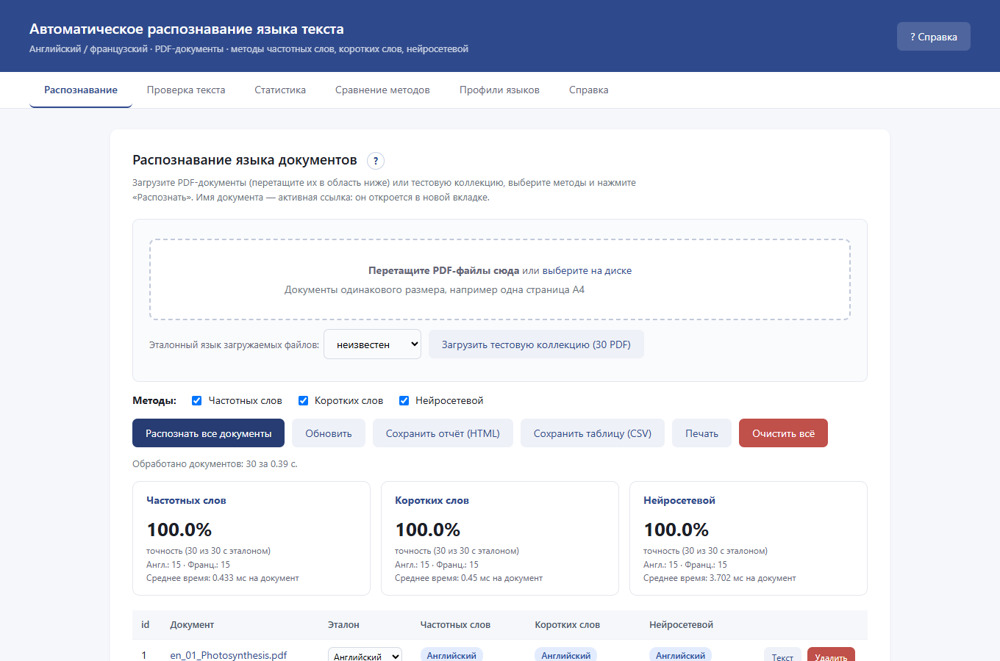
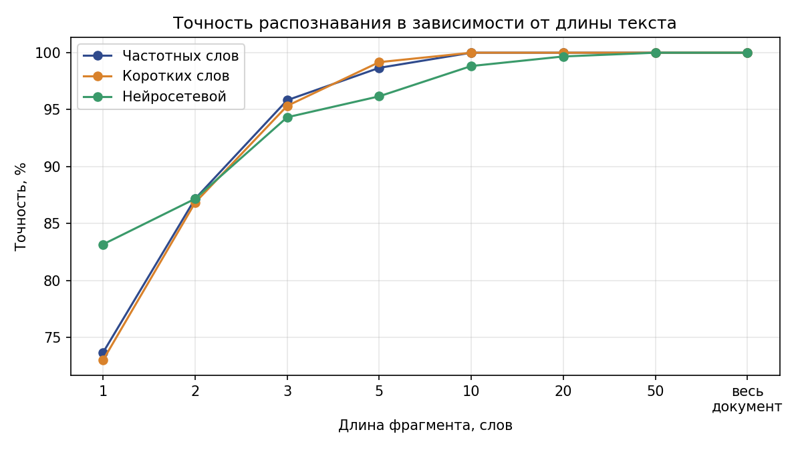
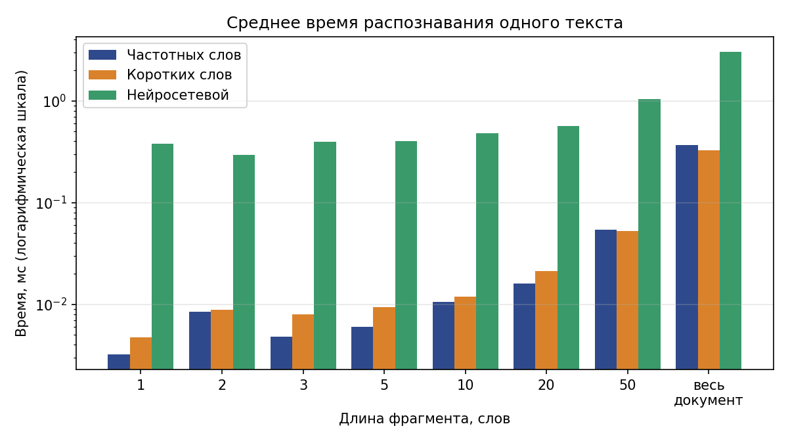
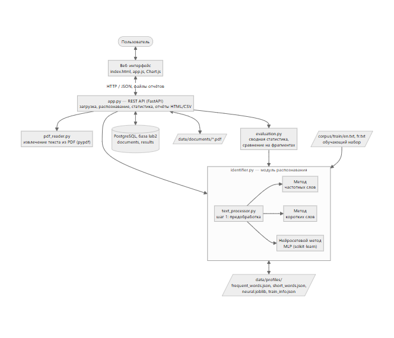
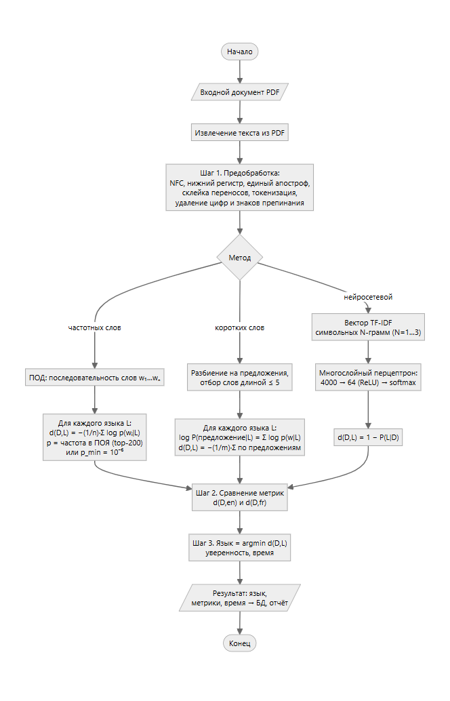
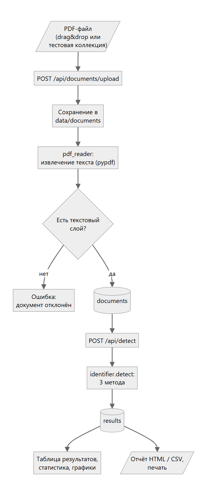
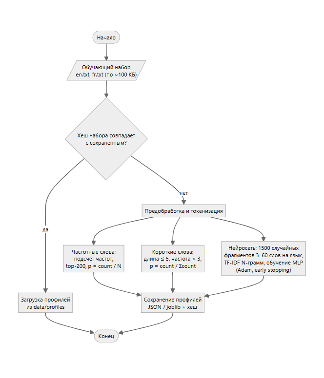
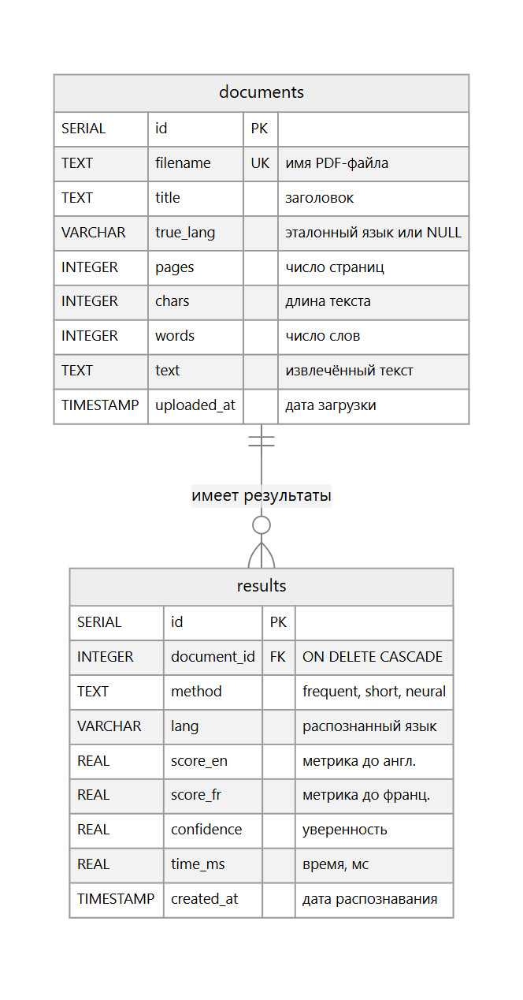

# ЛР 2. Автоматическое распознавание языка текста

Вариант 16: французский и английский языки, документы PDF. Используются три метода: частотных слов, коротких слов и нейросетевой.

Приложение извлекает текст из PDF и определяет его язык каждым из трёх методов. Результаты сравниваются с эталоном, отдельно строится зависимость точности от длины текста. Обучающий корпус — около 100 КБ текста на каждый язык.



## Запуск

```bash
psql -U postgres -f setup_db.sql     # однократно: пользователь ips и база lab2
uv sync
uv run uvicorn app:app --port 8002
```

Откройте http://127.0.0.1:8002 → «Загрузить тестовую коллекцию» → «Распознать все документы».

При первом запуске профили языков строятся из `corpus/train` и сохраняются в `data/profiles`. Нейросеть обучается около 3 секунд. Если обучающие тексты меняются, профили переобучаются автоматически.

## Методы

| Метод | Идея | Где |
|---|---|---|
| Частотных слов | профиль из 200 самых частых слов языка; язык — профиль с наименьшей метрикой расстояния | `methods.py: FrequentWordsMethod` |
| Коротких слов | частоты коротких слов (до 5 букв: артикли, предлоги, союзы), голосование по предложениям | `methods.py: ShortWordsMethod` |
| Нейросетевой | MLP (64 нейрона) на TF-IDF признаках, обучение на фрагментах корпуса | `methods.py: NeuralMethod` |

На тестовой коллекции из 30 PDF (15 en + 15 fr) все три метода дают точность 100%. На коротких фрагментах методы различаются, это видно на графике ниже. Подробные цифры — в [`results/benchmark.json`](results/benchmark.json).

<p>
  
  
</p>

## Схемы

| | |
|---|---|
|  |  |
|  |  |



Исходники схем — Mermaid (`docs/diagrams/*.mmd`), схема БД — также в [DBML](docs/diagrams/db_schema.dbml).

## Вспомогательные скрипты

Требуют группу зависимостей `dev`, её ставит `uv sync`.

```bash
uv run python tools/build_corpus.py      # корпус из статей Википедии → corpus/train, corpus/test
uv run python tools/benchmark.py         # тестирование без интерфейса → results/benchmark.json, графики
uv run python tools/screenshots.py       # скриншоты интерфейса (сервер должен быть запущен)
uv run python tools/render_diagrams.py   # docs/diagrams/*.mmd → PNG
uv run python tools/make_report.py       # сборка отчёта docs/lab2.docx
```

`screenshots.py` и `render_diagrams.py` работают через Playwright и установленный Google Chrome (`channel='chrome'`).

## Файлы

```
app.py             REST API (FastAPI), отчёты HTML/CSV
identifier.py      построение и загрузка профилей, выбор языка
methods.py         методы частотных слов, коротких слов, нейросетевой
text_processor.py  предобработка текста
pdf_reader.py      извлечение текста из PDF (pypdf)
evaluation.py      сводная статистика и сравнение методов на фрагментах
db.py              PostgreSQL (база lab2): documents, results
templates/ static/ интерфейс
corpus/train       обучающие тексты en.txt, fr.txt
corpus/test        30 тестовых PDF + labels.json (эталонные языки)
tools/             скрипты корпуса, тестирования, скриншотов, схем и отчёта
results/           графики, скриншоты, benchmark.json
docs/              отчёт lab2.docx и схемы
data/              загруженные PDF и профили языков (создаётся автоматически)
```

Тексты корпуса взяты из статей Википедии (лицензия CC BY-SA).
