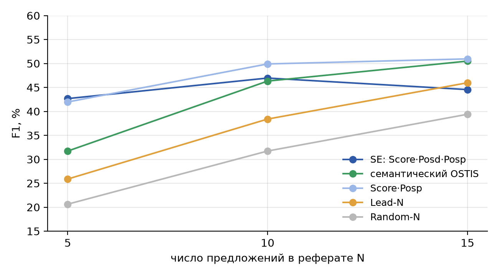
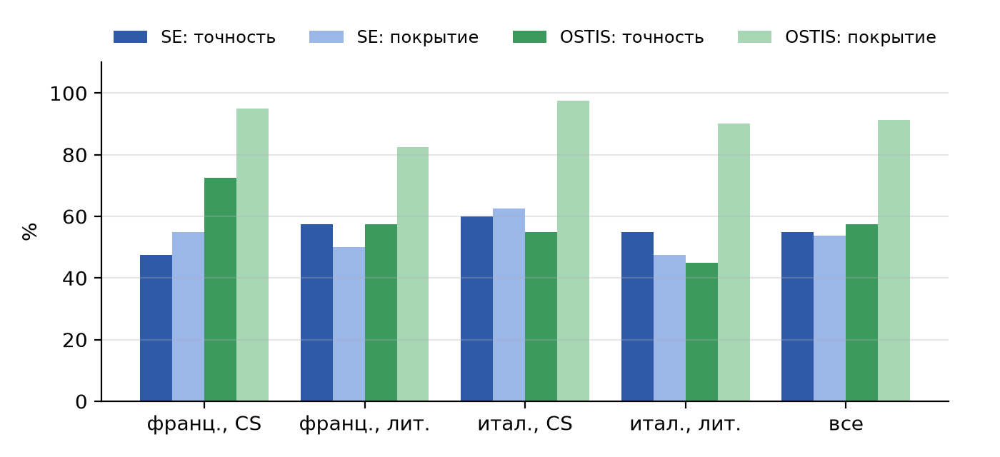
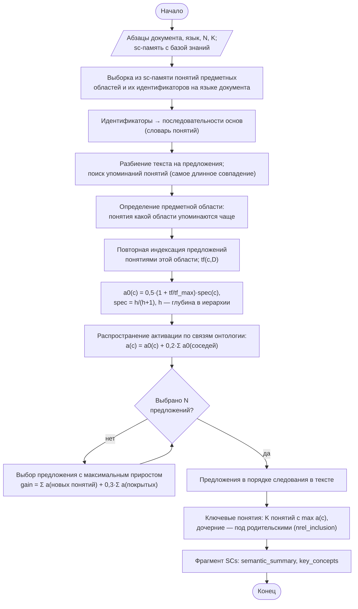
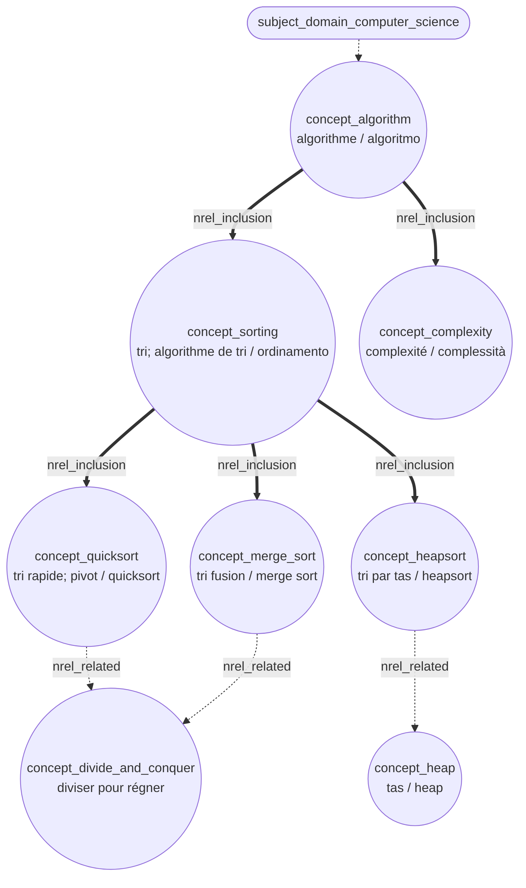
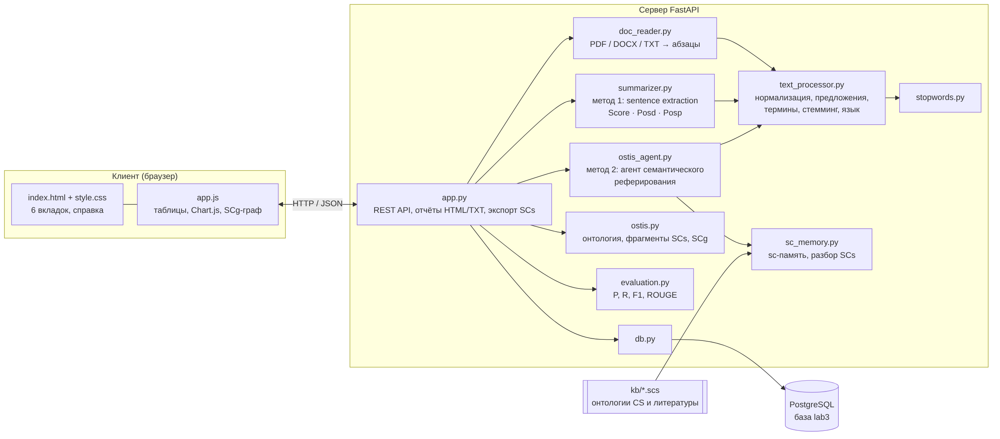
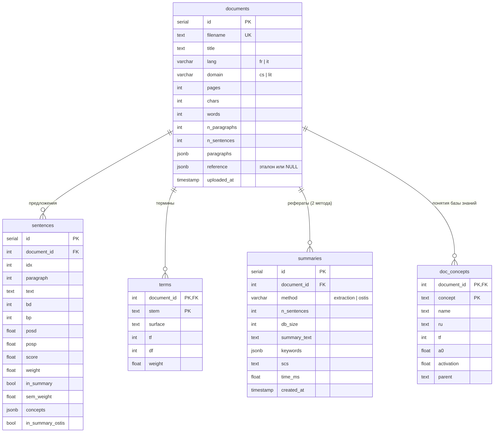

# ЛР 3. Автоматическое реферирование документов

Вариант 6: французский и итальянский языки; научные статьи по computer science и сочинения по литературе.

Для каждого документа (PDF / DOCX / TXT) параллельно работают **два метода**:

1. **Sentence extraction.** Вес предложения считается по формуле `Weight = Score · Posd · Posp`, где Score — сумма весов TF-IDF его терминов, а Posd и Posp — позиция предложения в документе и в абзаце.
2. **Семантический метод OSTIS.** Агент реферирования работает по базе знаний предметных областей, записанной в SC-коде (SCs): находит в тексте понятия онтологии, распространяет их важность по связям «включение» и «связано с» и выбирает предложения, которые покрывают самые важные понятия.

Реферат состоит из двух частей:
- **классический реферат** — выбранные предложения;
- **иерархический список ключевых слов** — для OSTIS это понятия базы знаний, сгруппированные по онтологии.

Результат можно сохранить (HTML / TXT / SCs) и распечатать; в интерфейсе есть справка.


## Запуск

```bash
psql -U postgres -f setup_db.sql     # однократно: пользователь ips и база lab3
uv sync
uv run uvicorn app:app --port 8003
```

Откройте http://127.0.0.1:8003 → «Загрузить тестовую коллекцию». Рефераты строятся сразу; переключатель «Sentence extraction / Семантический метод OSTIS» меняет метод.

Схема БД при запуске создаётся и обновляется автоматически: таблицы от прежней версии с одним методом дополняются новыми столбцами.

## Результаты на тестовой коллекции

16 документов (по 4 на каждое сочетание язык × область), эталонная разметка экспертом:

| | Sentence extraction | OSTIS |
|---|---|---|
| F1, реферат из 10 предложений | 47,0% | 46,3% |
| F1, 5 предложений | 42,7% | 31,7% |
| F1, 15 предложений | 44,5% | 50,5% |
| Покрытие эталонных ключевых слов | 53,8% | 91,2% |

<p>
  
  
</p>

Методы выбирают разные предложения: в среднем совпадают 3,9 из 10. Подробные цифры — в [`results/benchmark.json`](results/benchmark.json), готовые рефераты всей коллекции — в [`results/summaries_report.html`](results/summaries_report.html).

## Как устроен метод OSTIS

```
kb/src/*.txt ──tools/build_kb.py──► kb/*.scs ──sc_memory.py──► sc-память (граф sc-узлов и sc-дуг)
                                                                      │
документ ──► предложения ──► поиск понятий по fr/it идентификаторам ◄─┘
          ──► предметная область ──► важность понятий + распространение по связям
          ──► жадный отбор предложений ──► семантический реферат + ключевые понятия (SCs)
```

- База знаний: 181 понятие (114 — computer science, 67 — литература) с идентификаторами на ru / fr / it, отношениями `nrel_inclusion` и `nrel_related`.
- `sc_memory.py` — упрощённая sc-память на Python: разбор SCs, поиск по классам и отношениям. Это **не** sc-machine OSTIS, но синтаксис `.scs` совместим с базами знаний ostis-web-platform.

| | |
|---|---|
|  |  |
|  |  |

Остальные схемы лежат в [`results/diagrams/`](results/diagrams/), их исходники Mermaid — в [`tools/diagrams/`](tools/diagrams/).

## Файлы

| Файл | Назначение |
|---|---|
| `app.py` | REST API FastAPI, отчёты HTML/TXT, экспорт SCs |
| `doc_reader.py` | извлечение текста и абзацев из PDF / DOCX / TXT |
| `text_processor.py` | нормализация, предложения, термины, стемминг, язык и область |
| `stopwords.py` | стоп-слова французского и итальянского |
| `summarizer.py` | метод 1: веса w(t,D), Score, Posd, Posp, отбор предложений, ключевые слова |
| `ostis.py` | онтология реферирования, фрагменты SCs обоих методов, граф SCg |
| `sc_memory.py` | упрощённая sc-память: разбор SCs, sc-узлы, sc-ссылки, sc-дуги, поиск |
| `ostis_agent.py` | агент семантического реферирования по базе знаний |
| `corpus_format.py` | формат размеченных текстов коллекции (метки `[*]`) |
| `evaluation.py` | P, R, F1, ROUGE-1/2, базовые методы Lead-N и Random-N |
| `db.py` | схема PostgreSQL и её обновление |
| `templates/`, `static/` | интерфейс (Chart.js хранится локально в `static/vendor`) |
| `kb/` | база знаний `*.scs` и исходные таблицы понятий `kb/src/*.txt` |
| `corpus/src`, `corpus/test` | исходные тексты с эталонной разметкой; PDF коллекции и `labels.json` |
| `tools/` | скрипты коллекции, базы знаний, тестирования, графиков, скриншотов и схем |
| `results/` | графики, скриншоты, схемы, рефераты коллекции |
| `docs/lab3.docx` | отчёт |

## Вспомогательные скрипты

Требуют группу зависимостей `dev`, её ставит `uv sync`.

```bash
uv run python tools/build_corpus.py      # PDF и labels.json из corpus/src
uv run python tools/build_kb.py          # kb/*.scs из таблиц понятий kb/src
uv run python tools/benchmark.py         # тестирование → results/benchmark.json
uv run python tools/charts.py            # графики results/*.png
uv run python tools/screenshots.py       # скриншоты (сервер запущен; один раз: uv run playwright install chromium)
uv run python tools/render_diagrams.py   # схемы tools/diagrams/*.mmd → PNG (нужен Mermaid CLI: npm i -g @mermaid-js/mermaid-cli)
```

Тексты тестовой коллекции и эталонная разметка составлены специально для работы.
