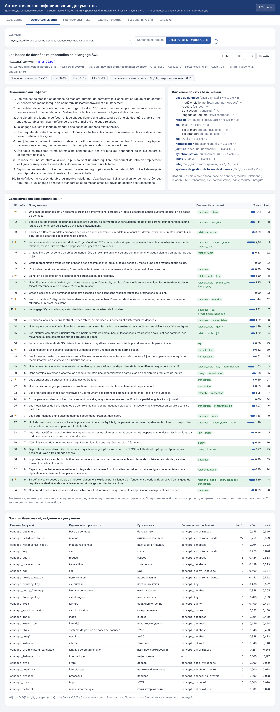
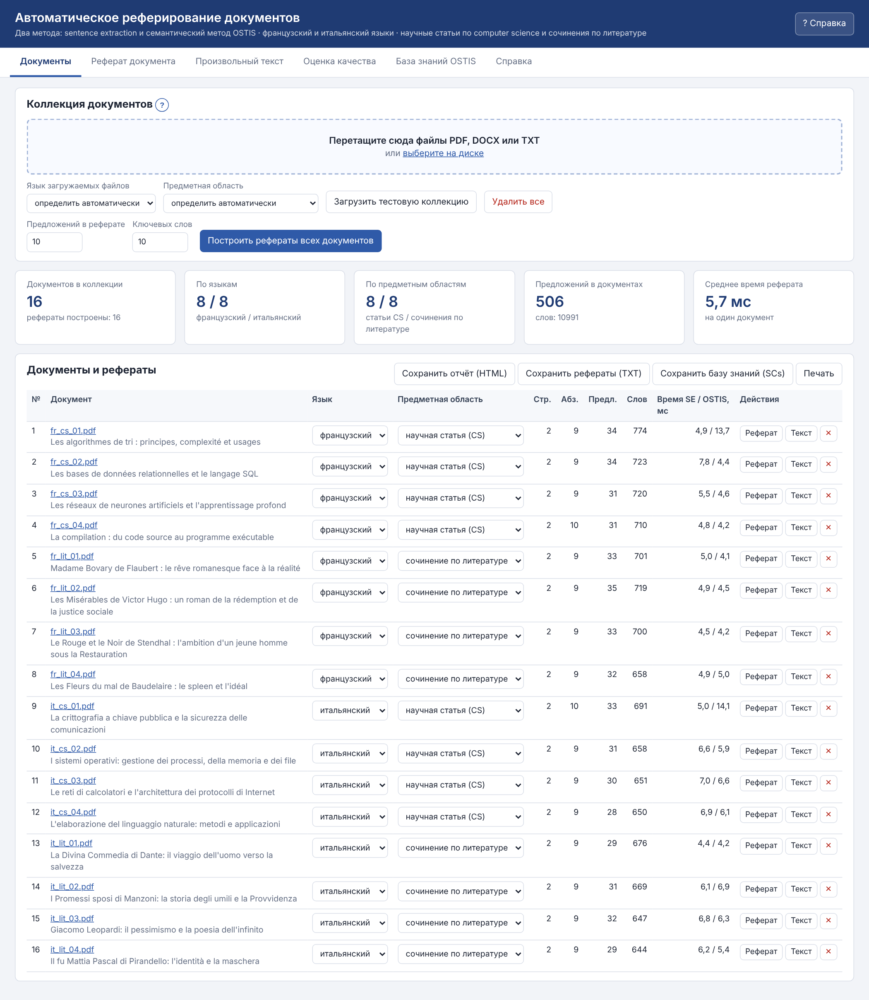
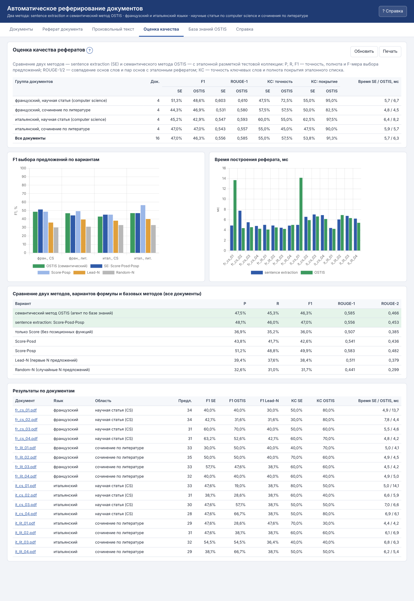
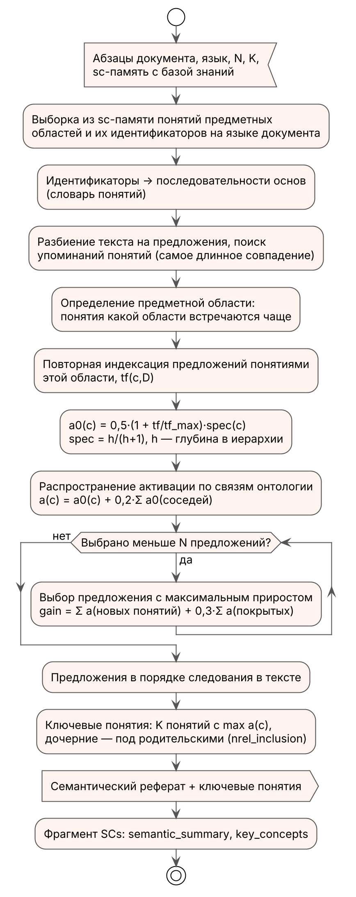
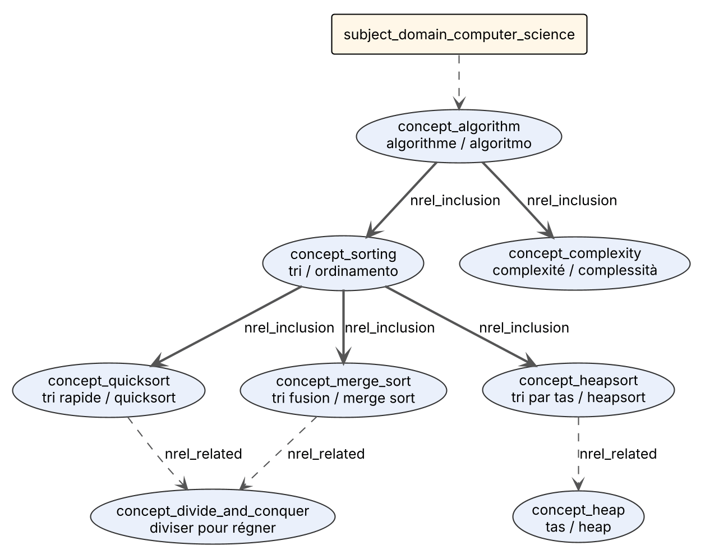
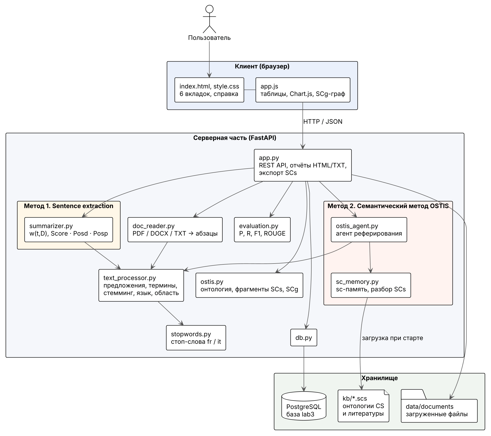
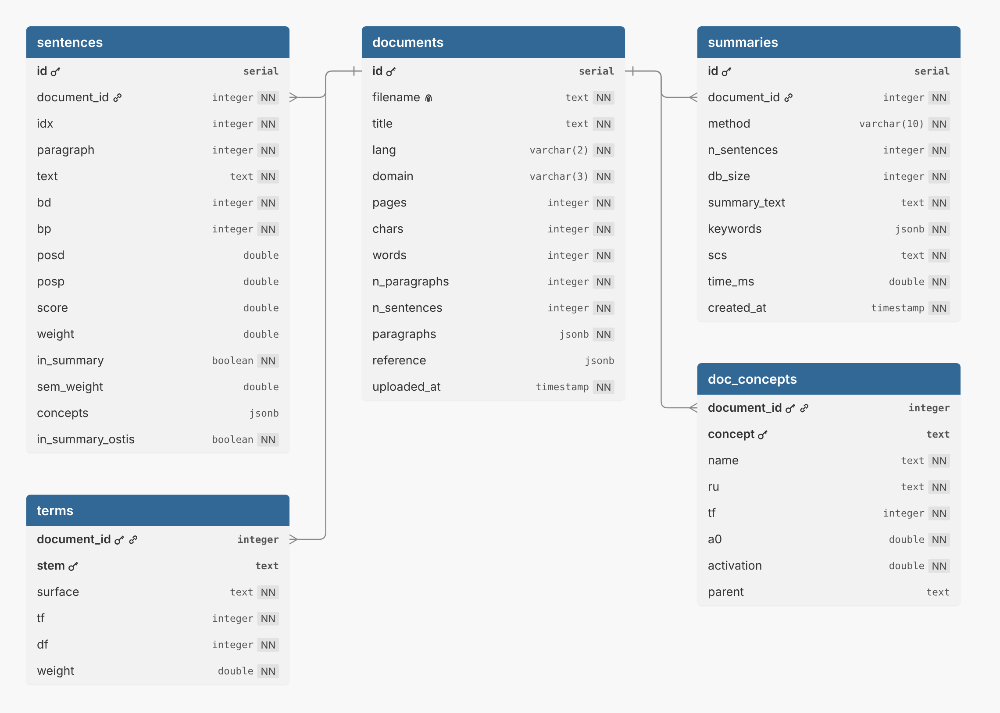

# ЛР 3. Автоматическое реферирование документов

Вариант 6: французский и итальянский языки; научные статьи по computer science и сочинения по литературе.

Для каждого документа (PDF / DOCX / TXT) параллельно работают **два метода**:

1. **Sentence extraction.** Вес предложения считается по формуле `Weight = Score · Posd · Posp`, где Score — сумма весов TF-IDF его терминов, а Posd и Posp — позиция предложения в документе и в абзаце.
2. **Семантический метод OSTIS.** Агент реферирования работает по базе знаний предметных областей, записанной в SC-коде (SCs): находит в тексте понятия онтологии, распространяет их важность по связям «включение» и «связано с» и выбирает предложения, которые покрывают самые важные понятия.

Реферат состоит из двух частей:
- **классический реферат** — выбранные предложения;
- **иерархический список ключевых слов** — для OSTIS это понятия базы знаний, сгруппированные по онтологии.

Результат можно сохранить (HTML / TXT / SCs) и распечатать; в интерфейсе есть справка.



## Запуск

```bash
psql -U postgres -f setup_db.sql     # однократно: пользователь ips и база lab3
uv sync
uv run uvicorn app:app --port 8003
```

Откройте http://127.0.0.1:8003 → «Загрузить тестовую коллекцию». Рефераты строятся сразу; переключатель «Sentence extraction / Семантический метод OSTIS» меняет метод.

Схема БД при запуске создаётся и обновляется автоматически.

<p>
  
  
</p>

## Результаты на тестовой коллекции

16 документов (по 4 на каждое сочетание язык × область) с эталонной разметкой экспертом. Время замерено на ноутбуке с Intel Core Ultra 9 185H.

| | Sentence extraction | OSTIS |
|---|---|---|
| F1, реферат из 10 предложений | 47,0% | 46,3% |
| F1, 5 предложений | 42,7% | 31,7% |
| F1, 15 предложений | 44,5% | 50,5% |
| Покрытие эталонных ключевых слов | 53,8% | 91,2% |
| Время построения реферата | 5,4 мс | 5,6 мс |

Методы выбирают разные предложения: в среднем совпадают 3,9 из 10. Подробный разбор — в отчёте [`docs/lab3.docx`](docs/lab3.docx).

## Как устроен метод OSTIS

```
kb/*.scs ──sc_memory.py──► sc-память (граф sc-узлов и sc-дуг)
                                        │
документ ──► предложения ──► поиск понятий по fr/it идентификаторам
          ──► предметная область ──► важность понятий + распространение по связям
          ──► жадный отбор предложений ──► семантический реферат + ключевые понятия (SCs)
```

- База знаний: 181 понятие (114 — computer science, 67 — литература) с идентификаторами на ru / fr / it, отношениями `nrel_inclusion` и `nrel_related`.
- `sc_memory.py` — упрощённая sc-память на Python: разбор SCs, поиск по классам и отношениям. Это **не** sc-machine OSTIS, но синтаксис `.scs` совместим с базами знаний ostis-web-platform.

| | |
|---|---|
|  |  |





Все схемы лежат в [`docs/diagrams/`](docs/diagrams/) вместе с исходниками: схемы на PlantUML (`*.puml`) и схема БД на DBML ([`db_schema.dbml`](docs/diagrams/db_schema.dbml) — её можно вставить на [dbdiagram.io](https://dbdiagram.io)).

## Файлы

| Файл | Назначение |
|---|---|
| `app.py` | REST API FastAPI, отчёты HTML/TXT, экспорт SCs |
| `doc_reader.py` | извлечение текста и абзацев из PDF / DOCX / TXT |
| `text_processor.py` | нормализация, предложения, термины, стемминг, язык и область |
| `stopwords.py` | стоп-слова французского и итальянского |
| `summarizer.py` | метод 1: веса w(t,D), Score, Posd, Posp, отбор предложений, ключевые слова |
| `ostis.py` | онтология реферирования, фрагменты SCs обоих методов, граф SCg |
| `sc_memory.py` | упрощённая sc-память: разбор SCs, sc-узлы, sc-ссылки, sc-дуги, поиск |
| `ostis_agent.py` | агент семантического реферирования по базе знаний |
| `corpus_format.py` | загрузка размеченных TXT вместе с эталоном (метки `[*]`) |
| `evaluation.py` | P, R, F1, ROUGE-1/2, базовые методы Lead-N и Random-N |
| `db.py` | схема PostgreSQL и её обновление |
| `templates/`, `static/` | интерфейс (Chart.js хранится локально в `static/vendor`) |
| `kb/*.scs` | база знаний: онтологии computer science и литературы |
| `kb/src/*.txt` | исходные таблицы понятий, из них `tools/build_kb.py` собирает `kb/*.scs` |
| `corpus/src/` | исходные тексты коллекции; метка `[*]` отмечает эталонные предложения |
| `corpus/test/` | тестовая коллекция (16 PDF) и эталонная разметка `labels.json` |
| `tools/` | `build_kb.py`, `build_corpus.py`, `benchmark.py` |
| `docs/` | отчёт `lab3.docx`, схемы и скриншоты |

## Вспомогательные скрипты

```bash
uv run python tools/build_kb.py       # kb/src/*.txt → kb/*.scs (после правки таблиц понятий)
uv run python tools/build_corpus.py   # corpus/src/*.txt → corpus/test/*.pdf и labels.json
uv run python tools/benchmark.py      # тестирование без интерфейса → results/benchmark.json
```

**Как добавить понятие в базу знаний.** Допишите строку в `kb/src/domain_cs.txt` или `kb/src/domain_lit.txt` в формате
`id | название ru | идентификаторы fr через ; | идентификаторы it через ; | родитель | связанные через ,`
и выполните `tools/build_kb.py`; новое понятие появится в `kb/*.scs` и после перезапуска сервера будет учитываться агентом.

**Формат исходного текста коллекции** (`corpus/src/*.txt`): заголовок `title:`, `lang:`, `domain:`, `keywords:` (эталонные ключевые слова через `;`), строка `===`, затем абзацы через пустую строку; `[*]` перед предложением — предложение входит в эталонный реферат. Такой файл можно загрузить и через интерфейс — эталон подтянется автоматически.

Бенчмарк записывает характеристики компьютера, время этапов и метрики качества обоих методов.

Тексты тестовой коллекции и эталонная разметка составлены специально для работы.
