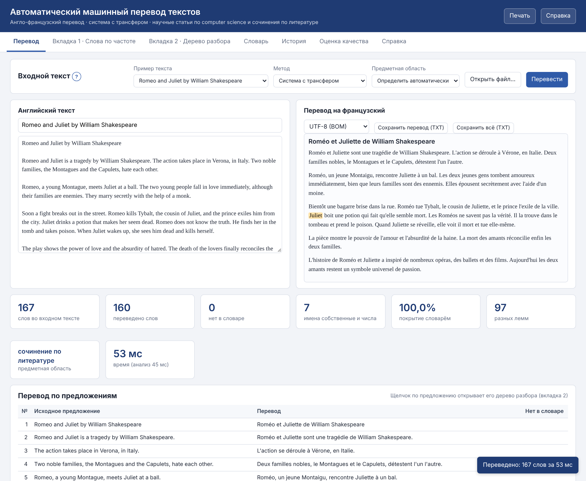
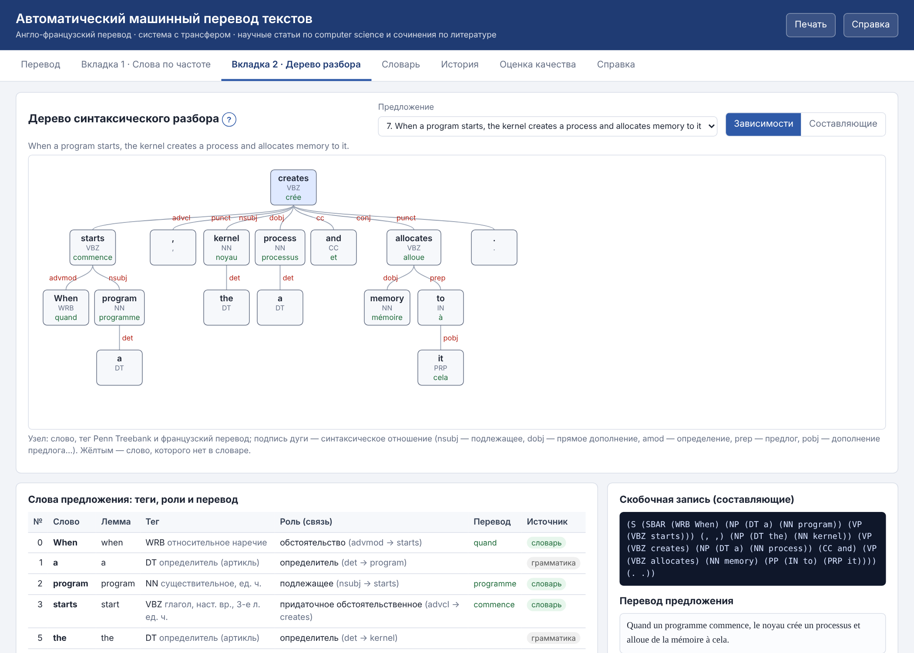
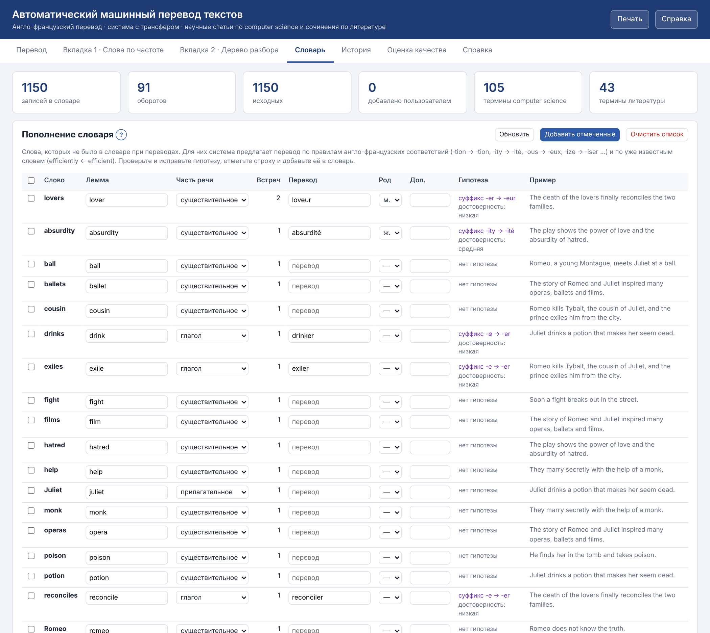
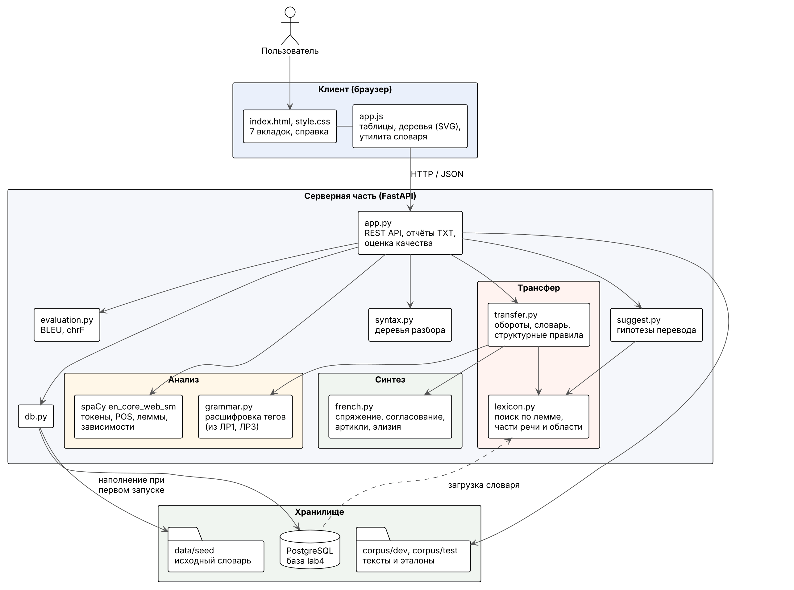

# ЛР 4. Автоматический машинный перевод текстов

Вариант 6: перевод с **английского на французский**; научные статьи по computer science и сочинения по литературе.

Перевод выполняет **система с трансфером** (rule-based MT), нейросетей нет:

1. **Анализ.** spaCy (`en_core_web_sm`) размечает части речи, леммы и строит дерево зависимостей.
2. **Лексический трансфер.** Сначала ищутся обороты из нескольких слов (самое длинное совпадение лемм), потом остальные слова по словарю: лемма + часть речи + предметная область.
3. **Структурный трансфер.** Обход дерева зависимостей:
   - порядок слов (прилагательное после существительного);
   - артикли;
   - время и залог;
   - `ne … pas`;
   - местоимения `le/la/lui`;
   - управление глаголов;
   - выбор предлогов (`in Italy → en Italie`).
4. **Синтез.** Спряжение всех групп глаголов, согласование в роде и числе, `à le → au`, элизия `le algorithme → l'algorithme`.

Для сравнения есть **пословный перевод** с тем же словарём, но без структурных правил.

Что ещё есть в интерфейсе:
- подсчёт слов во входном тексте и переведённых слов;
- **вкладка 1**: слова текста по частоте с переводом и грамматикой;
- **вкладка 2**: дерево зависимостей или составляющих для выбранного предложения;
- **утилита пополнения словаря**: неизвестные слова с гипотезами перевода по суффиксам (`-tion → -tion`, `-ity → -ité`, …);
- сохранение перевода и частотного списка в TXT (UTF-8 с BOM или UTF-16) и печать.



## Запуск

```bash
psql -U postgres -f setup_db.sql     # однократно: пользователь ips и база lab4
uv sync                              # ставит в том числе модель spaCy en_core_web_sm (≈ 12 МБ)
uv run uvicorn app:app --port 8004
```

Откройте http://127.0.0.1:8004, выберите пример текста и нажмите «Перевести».

При первом запуске таблицы создаются сами, а словарь заполняется из `data/seed/*.txt`: 1150 слов и 91 оборот.

<p>
  
  
</p>

## Результаты

Тексты разделены на две выборки по 8 текстов (4 CS + 4 литература, ~170 слов каждый), у каждого есть эталонный перевод:
- **`corpus/dev`** — на этих текстах отлаживались правила;
- **`corpus/test`** — отложенная выборка: правила на ней не менялись.

| | BLEU | chrF |
|---|---|---|
| dev, трансфер | 92,4 | 96,9 |
| test, пословный перевод | 20,3 | 60,6 |
| test, трансфер | 53,3 | 76,0 |
| test, трансфер после пополнения словаря утилитой (+134 записи) | **72,2** | **88,1** |

Что видно из таблицы:
- На тестовой выборке до пополнения 12% слов отсутствовали в словаре.
- Пополнение словаря (файлы `data/replenishment/*.txt`) подняло BLEU почти на 20 пунктов, при этом правила не менялись.
- Оставшиеся ошибки — это ошибки разбора spaCy (`the system stores…` → `stores` как существительное), возвратные глаголы (`kills herself`) и subjonctif.

Подробнее — в отчёте [`docs/lab4.docx`](docs/lab4.docx).

Чтобы повторить пополнение в приложении: «Словарь» → «Импорт TSV» → выбрать файлы из `data/replenishment/`.



Все схемы лежат в [`docs/diagrams/`](docs/diagrams/) вместе с исходниками:
- схемы на PlantUML (`*.puml`);
- схема БД на DBML ([`db_schema.dbml`](docs/diagrams/db_schema.dbml)) — её можно вставить на [dbdiagram.io](https://dbdiagram.io).

## Файлы

| Файл | Назначение |
|---|---|
| `app.py` | REST API FastAPI: перевод, загрузка файлов, отчёты TXT, словарь, история, оценка качества |
| `transfer.py` | ядро: `Translator` (текст, область, статистика), `Realizer` (лексический и структурный трансфер предложения), пословный метод |
| `french.py` | синтез: спряжение, согласование, артикли, слияния, элизия, типографика |
| `lexicon.py` | словарь в памяти: поиск по лемме, части речи и области, индекс оборотов |
| `grammar.py` | расшифровка тегов и ролей, словарная статья лексемы (из ЛР 1 и ЛР 3 весеннего семестра) |
| `syntax.py` | деревья зависимостей и составляющих для вкладки 2 |
| `suggest.py` | гипотезы перевода неизвестных слов |
| `evaluation.py` | BLEU-4 и chrF |
| `db.py` | схема PostgreSQL и начальное наполнение словаря |
| `templates/`, `static/` | интерфейс |
| `data/seed/` | исходный словарь: `dict_*.txt` (формат `en \| POS \| fr \| род \| доп. \| область`) и `phrases.txt` |
| `data/replenishment/` | записи, добавленные утилитой пополнения при тестировании |
| `corpus/dev`, `corpus/test` | английские тексты (`en/`) и эталонные переводы (`fr/`) |
| `tools/` | `benchmark.py`, `try_translate.py` |
| `docs/` | отчёт `lab4.docx`, схемы и скриншоты |

## Вспомогательные скрипты

```bash
uv run python tools/try_translate.py corpus/test/en/cs_os.txt     # перевод в консоли, без БД
uv run python tools/benchmark.py                                  # BLEU/chrF, время → results/benchmark.json
uv run --group dev python tools/charts.py                         # графики для отчёта
```

**Формат словаря.** В поле «доп.» записываются нерегулярные формы и флаги:

| Запись | Значение |
|---|---|
| `pl=…` | множественное число |
| `f=…` | женский род прилагательного |
| `mv=…` | форма перед гласной (`nouvel`) |
| `pre` | прилагательное стоит перед существительным |
| `aux=être` | вспомогательный глагол être |
| `obj=à` | дополнение-лицо с предлогом à |
| `inf=de` | предлог перед инфинитивом |
| `on=à` | предлог, которым управляет глагол |
| `asp` | h придыхательное (без элизии) |

Тексты и эталонные переводы составлены специально для работы.
